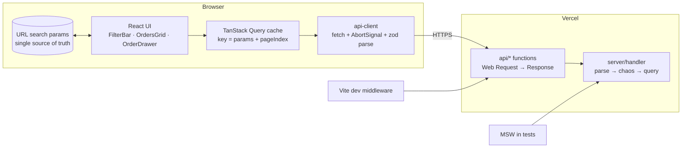

# Architecture

> Status: Phase 0. Sections marked _(planned)_ describe the agreed design and are updated as each phase lands.

## 1. Requirements

| #   | Requirement                                                | Acceptance criteria                                                                                                                      |
| --- | ---------------------------------------------------------- | ---------------------------------------------------------------------------------------------------------------------------------------- |
| R1  | ≥10k records; server-side search, filter, sort, pagination | 25k orders; `GET /api/orders` takes `q`, filters, `sort`, `offset`, `limit` → `{items,total,offset,limit}`                               |
| R2  | 200 ms–3 s random latency; ~1 in 10 requests fail          | Uniform delay in [200, 3000] ms; 10% return 5xx JSON errors                                                                              |
| R3  | Never show stale results                                   | Debounced search (300 ms); superseded requests aborted **and** isolated by cache key; a late response never renders                      |
| R4  | State in the URL                                           | q, filters, sort and scroll anchor `row` in the URL; refresh, back/forward and shared links restore the view                             |
| R5  | Fast with large lists                                      | Virtualized rows; smooth scroll across 25k rows; memoized rows                                                                           |
| R6  | Honest states                                              | Distinct initial-loading, updating (dimmed), empty, error and partial-failure states; Retry on every error; old data never looks current |
| R7  | Accessible                                                 | Keyboard-only operation, visible focus, counts announced politely and errors assertively, zero axe violations                            |
| R8  | Detail view                                                | `/orders/:id?…` drawer; deep-linkable; closing preserves list scroll and filters                                                         |

Assumptions and out-of-scope items (auth/RBAC, real search infra, tracing) are recorded in `docs/adr/`.

## 2. System overview



One pure handler is shared by three hosts: Vercel, the Vite dev server and MSW (ADR 0001). Explorer state lives in the URL (ADR 0002).

## 3. Module boundaries

| Path             | Contains                                   | May import           |
| ---------------- | ------------------------------------------ | -------------------- |
| `shared/`        | zod contract + inferred types              | zod only             |
| `server/`        | dataset, query, chaos, handler (pure)      | `shared/`            |
| `api/`           | Vercel route entry points (thin)           | `server/`, `shared/` |
| `src/ui/`        | design tokens + accessible primitives      | React                |
| `src/lib/`       | api client, query client, announcer, utils | `shared/`, `src/ui/` |
| `src/features/*` | explorer feature modules                   | everything in `src/` |

These rules are enforced by `no-restricted-imports` in `eslint.config.js`.

## 4. Never-stale data flow _(planned, Phase 3)_

```mermaid
sequenceDiagram
  participant U as User typing
  participant I as SearchInput (local state)
  participant URL
  participant Q as useQueries(pageKeys)
  participant S as Server
  U->>I: "a","ab","abc"
  I-->>URL: debounced 300ms → replace ?q=abc
  URL->>Q: key ["orders", {q:"abc"}, page 0]
  Note over Q: previous key's fetch → signal.abort()
  Q->>S: GET q=abc (AbortSignal)
  S-->>Q: 200
  Note over Q: a late "ab" response can only write to the "ab" key
  Q-->>U: rows for "abc"; live region "1,204 orders"
```

There are three independent defences: **debounce**, **abort**, and **key isolation** (data is read only from the query for the current URL-derived key).

## 5. URL schema _(planned, Phase 2)_

`/orders?q=&status=paid,shipped&country=US,DE&payment=card&minTotal=&maxTotal=&from=&to=&sort=createdAt:desc&row=0`
and `/orders/:orderId?<same params>` for the detail drawer.

- Serialization is canonical (defaults omitted, stable ordering). Invalid params are normalized with `replace`.
- Keystrokes and scroll anchor updates use `replace`; filter, sort and detail-open use `push`.

## 6. Security

- All query params are validated server-side with an allowlisted sort and a capped `limit`. There are no secrets in the repo or the client.
- `dangerouslySetInnerHTML` is banned by lint. CSP and security headers ship in `vercel.json` _(planned, Phase 7)_.
- Chaos overrides (`x-chaos`) are honored only when `ALLOW_CHAOS_OVERRIDE` is set.
